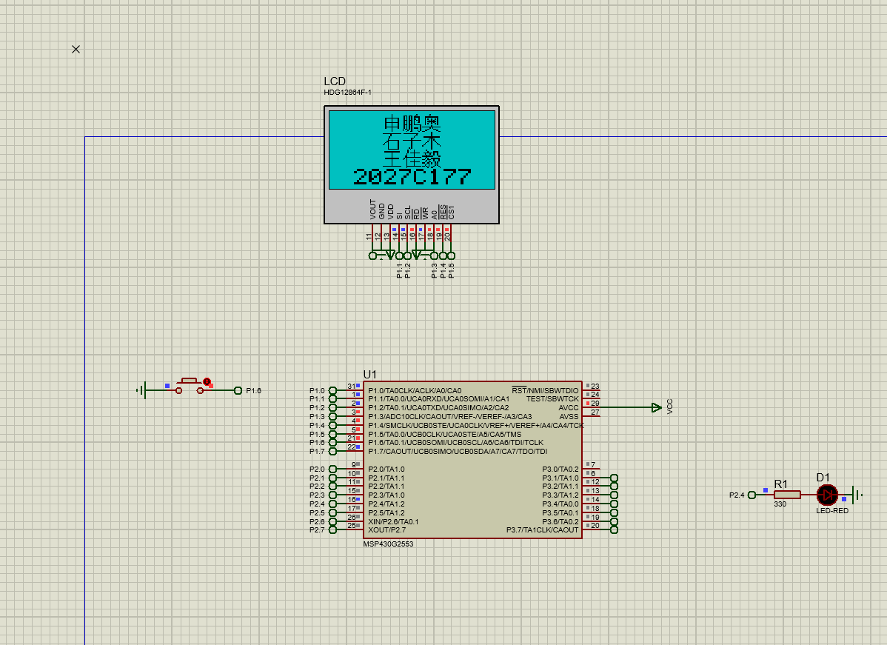
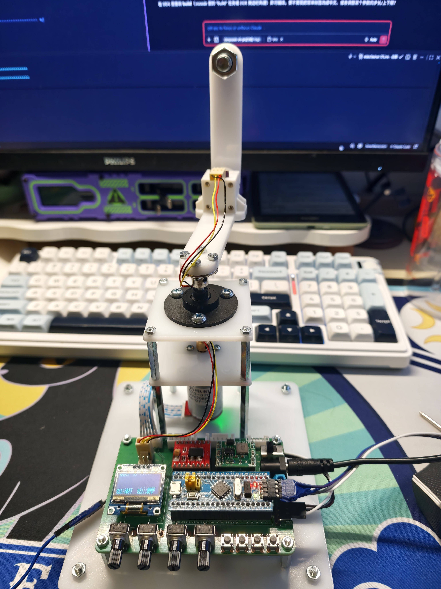
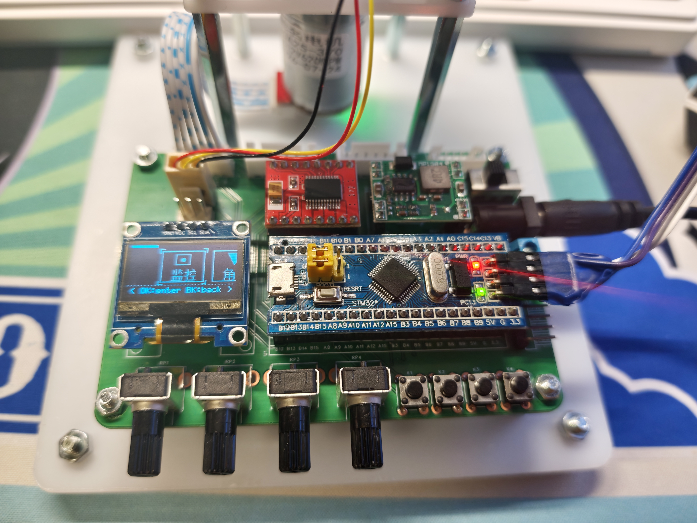
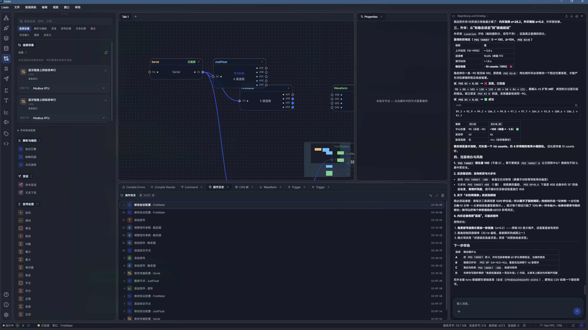

# 学习日记

> 记录长期学习嵌入式系统与各种知识过程中的碎片、踩坑与思考，按时间顺序持续追加。

## 2026-11-3

ok很高兴速成了一下markdown的写法,原来比HTML还简单,应该早点学的

这几天准备了一下电子信息杯的内容,第一次用Proteus,第一次接触德州仪器,第一次从底层开始写屏幕驱动,第一次尝试并口屏后以失败告终(有一部分原因是因为并口屏幕太占引脚了,于是后面老老实实用串口屏了)

(补记,本来以为仿真中屏幕刷新率低是软件问题,后来发现很大一部分是串口屏和芯片的问题,我还想再次移植Astro UI来混一下其他功能的分数,还是继续研究并口屏吧QAQ)

## 2026-11-06

##### 这几天跟着江科大系统的学习了一下pid的内容,做了一个倒立摆

跟着教程做出来之后又不满足于此,于是乎移植了一个框架,这样能够在丝滑的ui框架下实现切换内层外层pid的调节,来辅助调参

但是尽管如此,调参的过程还是太过于痛苦且玄学了,有没有更加简单高效的方法呢?

有的有的,在ai的时代,我们或许可以借助串口通信来实现ai调参

于是乎我找到了Lissio这个原生可以接入大模型的串口助手(更优雅的无线串口方案可能需要自己设计一个泛用型强的)

在经过了一段时间的调试与生成之后,我成功地借助了 AI 进行pid调参rt
>请不要忘记让接收到的数据写入csv,这样agent才能够完整的读到内容

受限于硬件的不稳定,最终也没能做到一些视频中的完美效果,不过最终的效果依旧是让人惊喜的,甚至在一次运行中倒立摆稳稳的立在了期望的位置,没有任何抖动

相较于传统的pid调参,ai调参最大的特点和优点就是省时与科学,或许有时间可以做个skill来让该流程标准化,全自动

## 2026-11-11
##### ok,成功通过了RM电控组的面试,开始学习C板电机啥的准备队内开发
然后昨天在实验室泡了一天,把实验室物料的位置啥的了解差不多了,成功驱动了6020的直流无刷电机,再然后就是会用实验室的3d打印机了

