# 碎碎念的简历

之前也没写过简历，所以这一次就以一个回忆录的形式，来记录一下我与编程、与嵌入式、与 RoboMaster 的缘分

希望组长可以别嫌我啰唆(bushi

最开始接触编程是在网课时期。当时学的是前端，第一个编程语言是 JavaScript。得益于前端即时的正反馈，我确实学会了设计一个不太复杂的网页(做的网页通过自媒体和打赏的形式，小小赚了一笔:))非常可惜的是，由于不够妥当的保管，我最终丢失了源码。

也是这段学习的经历鼓舞了我继续在我感兴趣的领域走下去。

接下来是初三，我第一次接触单片机，是 ESP32。当时是看到了一个通过驱动 TFT 屏幕并利用分光棱镜做的一个颜值很高的小摆件(如图：

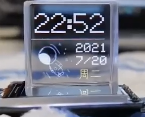

于是乎，便开启了 Arduino 的学习。得益于超级高度的封装，我在 Arduino 上几乎是毫不费力地了解了完整的单片机项目开发流程。随后也自己完成了一些，现在看来很简单，但是当时成功后超级兴奋的项目:O

比如通过蓝牙键鼠的库，以及 ESP32 自带的触摸引脚，来通过触摸苹果进行游戏内的按键操作。

再比如通过 PWM 控制舵机，以及 Blinker 的 API 做的一个远程开关灯的智能家居终端。那还是我第一次靠一点一点读开发文档，来进行一个没有任何学习资料的项目开发。

再后来，单单玩封装好的单片机与模块，已经不能满足我的探索欲望了。于是乎，从 2022 年开始，我便开始了在立创广场上复刻一些有意思的项目(当然，多以失败告终。不过，还是成功了四五个。

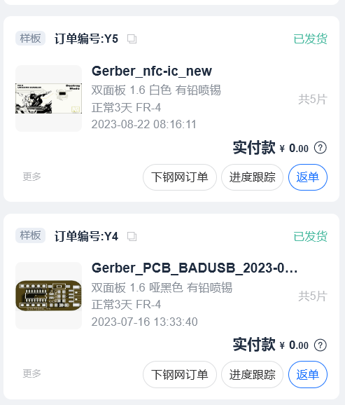 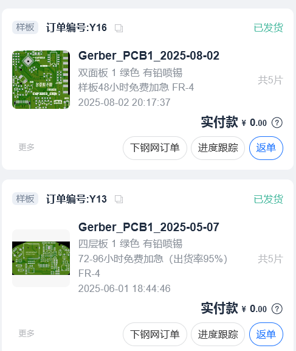

值得一提的是，左图下方那个通过CH552制作的 Bad USB 是我第一次接触 Keil5(更令当时的我感到震惊的是，这个本应该专注于串口通信的芯片，居然能在 Arduino 的框架下编程！

我甚至当时还发了一个 B 站(当时的我好稚嫩HHHH

[badusb] 插入电脑直接关机，伪装成u盘送给好兄弟当礼物吧 https://www.bilibili.com/video/BV1YP411r7G2?vd_source=f21953dcc3d18ce90390726643750b61

哦，对了，我也是在初中时期得知RoboMaster这一个超级极客的赛事的。当时我就在幻想，在我的大学时期，能不能在这样一个赛场上挥洒青春与汗水，当时的我估计怎么也没想到，我在大一就通过了层层考核来到了面试这一步。

后来上了高中，因为繁忙的学业，使我迫不得已搁置了这种需要大量整块时间学习的技术。放弃了一些底层知识的学习，转而投向了学习成本更低、且可以碎片化学习的技术

比如 3D 建模、游戏开发以及绘制简单的 PCB。

先说说 3D 建模吧。当时我是想着，一个完整产品的开发是离不开 3D 建模的，而且 3D 建模的知识在我未来的专业选择中也不会涉及，所以就想着趁还有时间，先把这一部分学习了。也有一点觉得，提前学习专业课的知识，然后上大学再学一遍，是一种时间上的浪费。不过，也正是因为有着提前的准备，让我能够在 RoboMaster 前两轮的选拔中脱颖而出。(附上一个 Blender 的时长。当然，看教程的时间和实操的时间加起来远比这个多。By the way，现在看来，这个想法或许是错误的，因为 GPT-6 确实可以比较完美地胜任设计外壳的工作。不过我并不后悔，因为一点一点建模、上材质并渲染出一个完整的场景，确实是一件可以令人获得满足感的事情。

最近做到一半的白模

 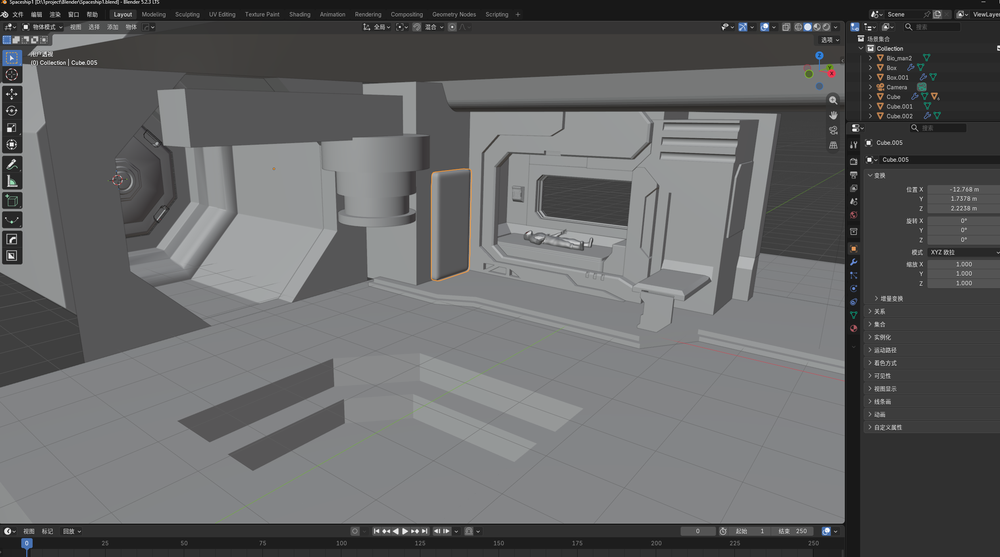

众多项目之一

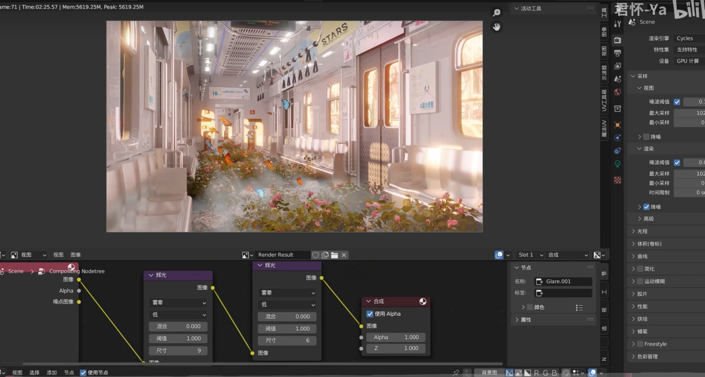

再说说游戏开发，不可否认的是我的确受到了国产游戏崛起的激励，也幻想着自己一个人能够独立完成一部作品，**讲好一个故事**，创造一个完整的、宏大的世界观。于是乎，在紧张的学习生活中，能够让我的精神获得放松的，便是构思自己脑海中的小世界。

并在当时，我超级喜欢的一款游戏《空洞骑士》，迎来了它的续作《丝之歌》

于是乎，我的第一个练习向的游戏作品便用了这一主题。整个战斗逻辑的编写是参照的教程，但是整个屏幕 UI 以及敌人的部分 AI 和一些招式是我自己的想法。(看上去还不错，对吧？

全部都是自己一行一行代码敲出来的。当时的 Godot 还没有 MCP

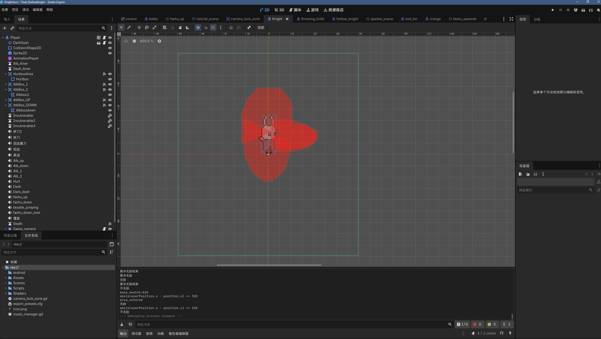 

欢迎学长来尝试击败我自己做的 BOSS(也提供安卓版本

再说一说绘制简单的 PCB 吧。当时是一个朋友做了蓝晶雨(最左边的图是找不到当时的成品了，是在网上找的，所以和第二个图的尺寸不匹配。

他问我有没有办法做一个照明的支架？我索性直接画了一块 PCB。也是挑战一下新的领域

 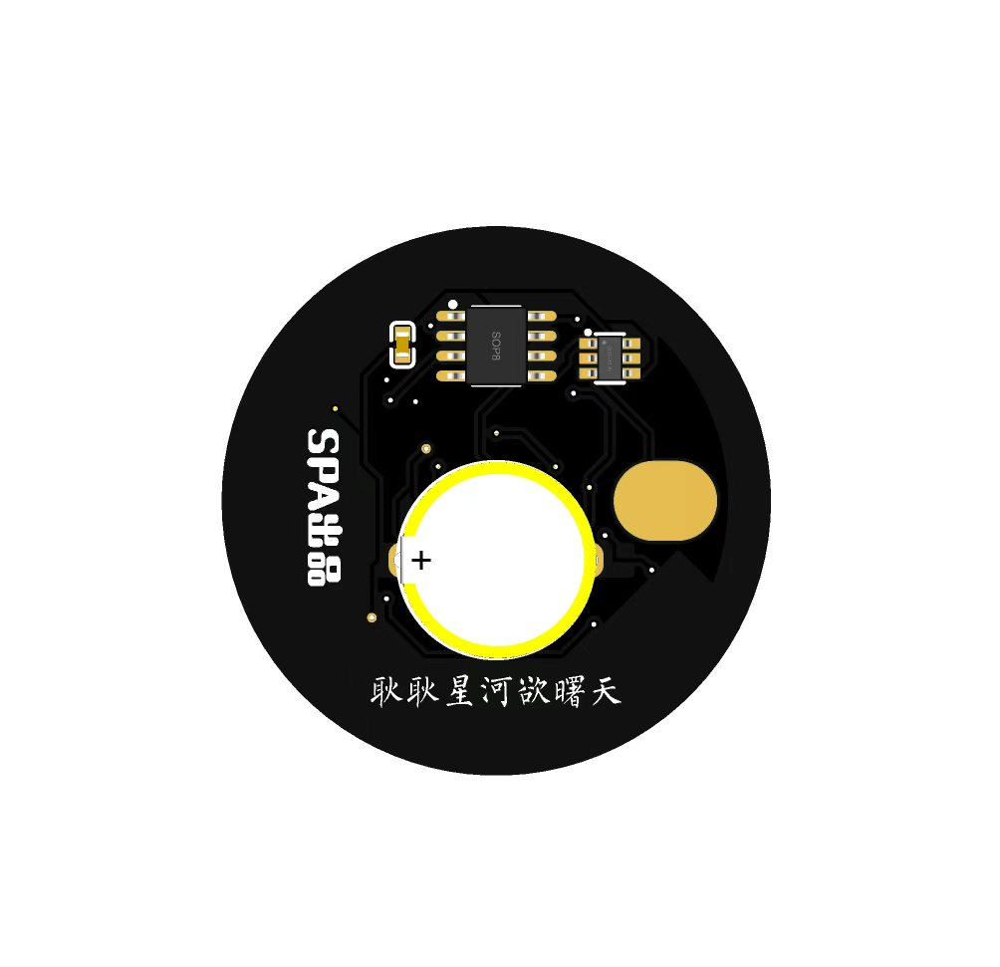 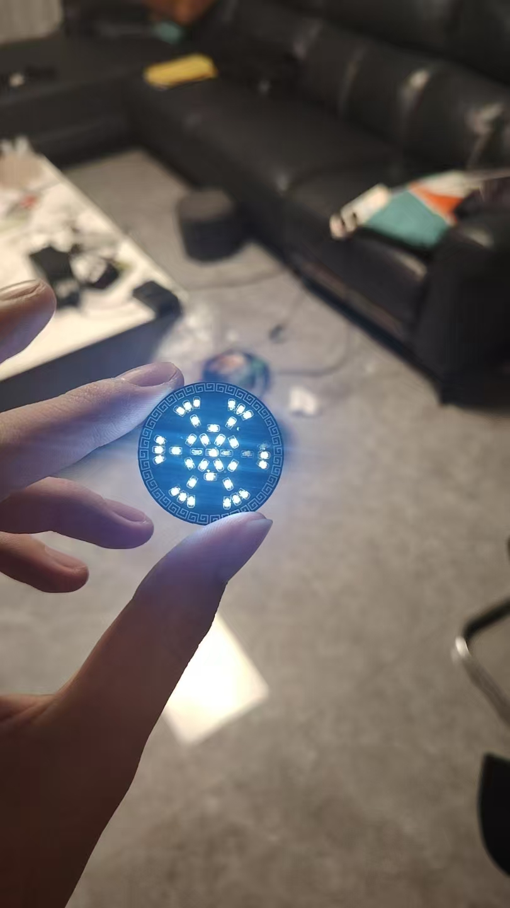 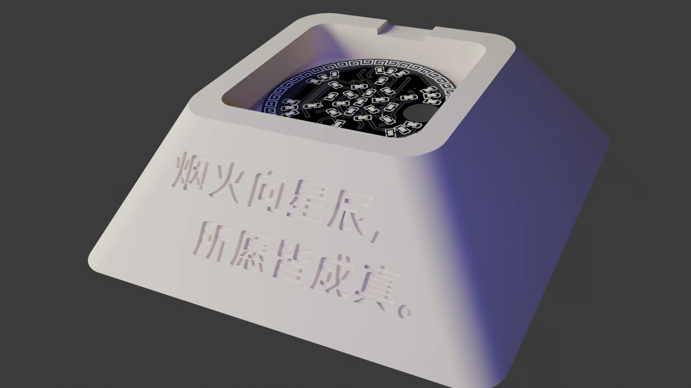

最后的渲染图是用blender做的

我去我说的好乱啊，高中也做了一些有意思的嵌入式项目的(不过都是arduino)比如通过接入舔狗日记api,按一下触摸引脚就在TFT屏幕上显示一段日记(很可惜被老师没收了,也没留下记录

(ai并不成熟的当时,我通过一种极其诡异的方式实现了汉字字库,用前端的底子写了一个高速调用api然后筛选独特字的网页,再然后用取模软件以次取模)

再然后就是高考结束的暑假了,再一次出于提前学习专业课的知识，然后上大学再学一遍，是一种时间上的浪费的心理,我并没有深入学习嵌入式的知识(假如学了我考核也不会如此吃力QAQ),而是被APEX掏空了身体(划掉)学了一些其他感兴趣的...

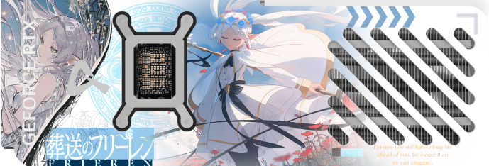 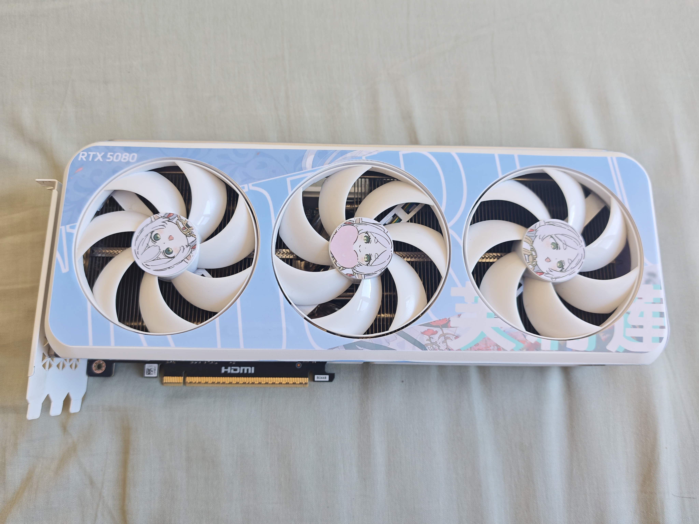 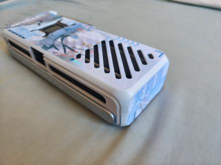

(炫耀一下完全自己设计的显卡贴纸)

OK,在之后就是上大学后听说RM招新然后参加了,以上与其说是我的简历,倒不如说是对我大学前学习生活的总结,也是在碎碎念HHHH

很感谢学长能读到这里,我当前的专业能力可能不是最出色的,但是相信学长也看到了,**我有着不错的学习能力和一颗对兴趣对未知永远充满激情并且愿意投入精力的心**

我会努力在实验室中快速学习与成长,在Robomaster中挥洒自己的青春与汗水,这很酷,不是吗

好久没写这么长内容了,语言组织有点差hh
